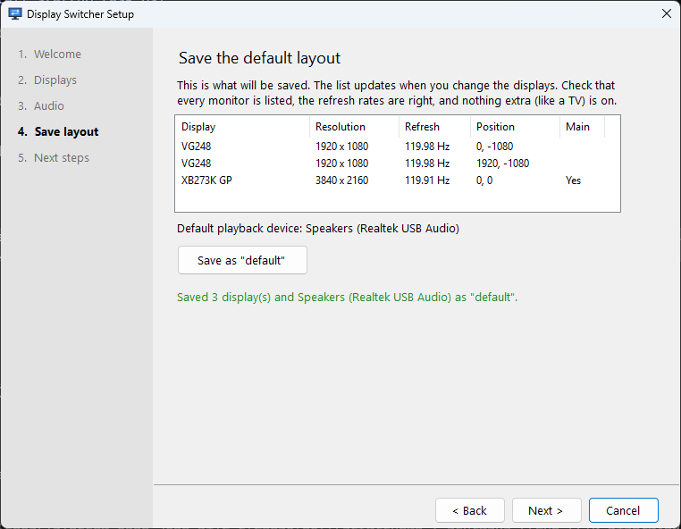
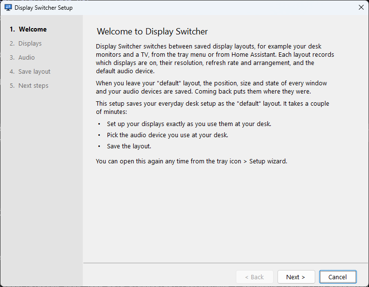
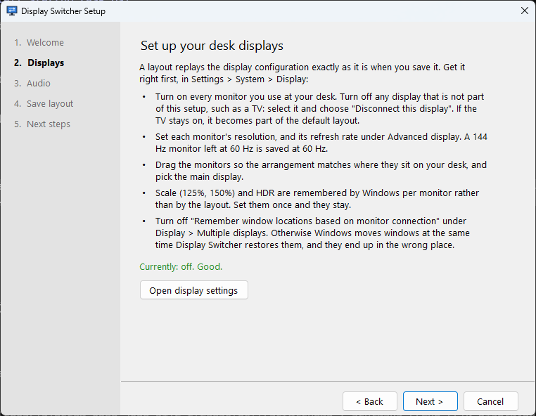
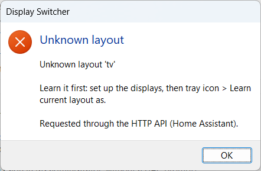
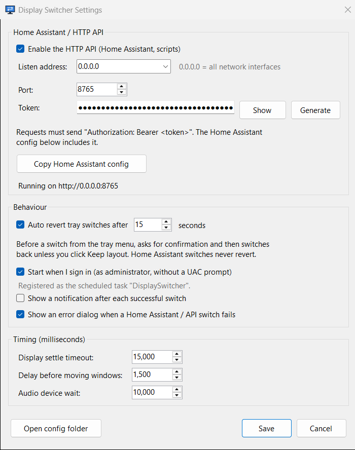

# Display Switcher

A Windows tray app that switches between saved display layouts, such as "three monitors
at the desk" and "TV only for gaming", from the tray menu or over HTTP (for example from
Home Assistant).

When you leave your desk layout it saves the position, size, state and stacking order of
every window, plus your default audio devices. When you come back, it puts them all back
where they were.

<p align="center">
  
</p>

## Features

- **Learned layouts.** Arrange the displays in Windows once, then save the arrangement
  under a name. A layout records which displays are on, plus their resolution, refresh
  rate, position and the main display. It also records the default playback device.
- **Window save and restore.** Leaving the `default` layout snapshots every window. This
  includes maximized, minimized and snapped windows, and the order in which windows
  overlap. Returning restores them on per-monitor-DPI setups (for example a 4K panel at
  150% next to 1080p panels at 100%).
- **Audio follows the layout.** Switching to the TV makes the TV's HDMI audio the default.
  Coming back restores your previous playback and communications devices.
- **Safe failure.** If a display in the target layout is off or unplugged, the switch
  stops before anything is touched, and a dialog explains why.
- **Auto revert.** A tray switch can come back on its own after a countdown unless you
  click Keep, like Windows' "Keep these display settings?" prompt. Useful while setting
  up a TV that might not show a picture.
- **HTTP API** for Home Assistant, Stream Deck or scripts, protected by a bearer token
  generated on first run.
- **Idempotent.** Asking for the layout that is already active does nothing.
- **Setup wizard** on first run that walks through getting displays and audio right
  before saving the first layout.
- **Installer** that bundles .NET, so the target PC needs no runtime. It sets up a logon
  task that starts the app elevated without a UAC prompt, and adds a firewall rule.

## Contents

- [Requirements](#requirements)
- [Install](#install)
- [Getting started](#getting-started)
- [Using it](#using-it)
- [Home Assistant](#home-assistant)
- [HTTP API](#http-api)
- [Configuration files](#configuration-files)
- [How it works](#how-it-works)
- [Security](#security)
- [Troubleshooting](#troubleshooting)
- [Building from source](#building-from-source)
- [Limitations](#limitations)

## Requirements

- Windows 10 2004 (build 19041) or later, x64. Developed and tested on Windows 11.
- Any GPU whose driver supports the Windows display configuration API (every current
  NVIDIA, AMD and Intel driver does).

## Install

Download `DisplaySwitcher-Setup-<version>.exe` from the
[Releases](https://github.com/joejenniges/display-switcher/releases) page and run it.
The installer:

- installs to `C:\Program Files\Display Switcher`.
- optionally registers a scheduled task named `DisplaySwitcher`. It starts the app at
  sign-in **as administrator, without a UAC prompt**. Elevation matters: without it,
  Windows won't let the app move or minimize windows that belong to elevated programs
  (Task Manager, admin terminals, some game launchers).
- optionally adds a Windows Firewall rule for the app on private and domain networks, so
  Home Assistant on another machine can reach the API.

Upgrading is the same: run the newer installer. It stops the running copy first. Your
layouts and settings live in `%APPDATA%\display-switcher` and are kept.

Uninstalling removes the task and the firewall rule, and asks whether to delete your
layouts and settings.

## Getting started

### 1. Save your desk layout ("default")

On first start the setup wizard opens. It can be reopened later from **tray > Setup
wizard**.

| | |
|---|---|
|  |  |

It walks you through:

1. **Displays.** Turn on every desk monitor, and disconnect anything that isn't part of
   the desk setup, such as the TV. Set each monitor's resolution and refresh rate. The
   refresh rate is under *Advanced display*; a 144 Hz monitor left at 60 Hz is saved at
   60 Hz. Arrange the monitors and pick the main one.
2. **"Remember window locations based on monitor connection".** Turn this off under
   *Settings > System > Display > Multiple displays*. With it on, Windows moves windows at
   the same moment Display Switcher restores them, and they end up in the wrong place. The
   wizard shows whether it is off.
3. **Audio.** Make your desk speakers or headset the default playback device.
4. **Save.** The wizard lists exactly what will be saved, updating as you change things,
   and saves it as `default`.

Scale (125%, 150%) and HDR are remembered by Windows per monitor, not by the layout. Set
them once and they stay.

### 2. Save your TV layout ("tv")

1. Turn the TV on and switch it to the PC's input.
2. Make the TV the only active display. In display settings, select each desk monitor and
   choose *Disconnect this display*. With only one other display, *Win+P > Second screen
   only* also works.
3. Set the TV's resolution and refresh rate (for example 3840 x 2160 at 120 Hz). Turn on
   the TV's game mode, because without it the TV adds noticeable input lag.
4. Make the TV's audio device the default playback device. HDMI audio devices only exist
   while that display is on, which is why this step happens now and not in the wizard.
5. **Tray > Learn current layout as > New layout...**, and name it `tv`.
6. Switch back with **tray > default**. Your windows and audio come back.

You can save as many layouts as you like. Names are 1-64 letters, digits, `-` or `_`.

## Using it

### Tray menu

Right-click the tray icon:

- **Layout names.** Switch to that layout. The active one is checked.
- **Restore saved windows for '...'.** Appears when a snapshot exists for the current
  layout. Recovery for a switch that was interrupted after the displays changed.
- **Auto revert (15 s).** Toggle, described below.
- **Learn current layout as.** Save the current displays and audio under an existing or
  new name.
- **Settings..., Setup wizard..., Open config folder, View log, Exit.**

Double-clicking the icon opens Settings. Starting the app again, for example from the
Start menu, also opens Settings in the copy that is already running.

### Auto revert

On by default with 15 seconds. When you switch from the tray:

1. The target layout is checked first. If the TV is off, you get an error instead of a
   prompt.
2. A confirmation says the switch will be reverted after 15 seconds.
3. After the switch, a **Keep the 'tv' layout?** countdown appears on the new display. If
   you click *Keep layout*, it stays. If you click *Revert* or let the countdown run out,
   it switches back and restores your windows. *Enter* reverts, as in Windows' own display
   prompt, in case the screen shows nothing.

Switches made through the API never auto-revert, since nobody is at the PC to click Keep.
Turn auto revert off from the tray menu once your layouts work.

### Errors

A failed switch shows a dialog with the reason, for example *Display not detected:
HISENSE ... Nothing was changed*. API-triggered failures show the same dialog unless that
is turned off in Settings. This is deliberate: Windows 11 silently drops tray balloon
notifications under Do Not Disturb and game mode, so a balloon is not a reliable way to
report an error.

<p align="center">
  
</p>

### Settings

<p align="center">
  
</p>

| Setting | Default | |
|---|---|---|
| Enable the HTTP API | on | Turn the listener on or off. |
| Listen address | `0.0.0.0` | `0.0.0.0` = all network interfaces, `127.0.0.1` = this PC only, or one LAN address. |
| Port | `8765` | |
| Token | random, generated on first run | Requests must send `Authorization: Bearer <token>`. *Generate* creates a new one. Clearing it opens the API to every device on the network, and Settings warns when it's empty. |
| Auto revert | on, 15 s | Tray switches only. |
| Start when I sign in | on (installer) | Creates or removes the elevated logon task. Asks for admin approval if the app isn't elevated. |
| Notification after each switch | off | Tray balloon on success. |
| Error dialog for API failures | on | |
| Display settle timeout | 15000 ms | Maximum wait for Windows to report the new display arrangement. |
| Delay before moving windows | 1500 ms | Extra wait after the displays settle, before windows are restored. |
| Audio device wait | 10000 ms | Maximum wait for the target audio device. HDMI audio appears a few seconds after the display. |

Saving applies immediately. The API is restarted on the new address without restarting
the app. **Copy Home Assistant config** puts a ready-to-paste `rest_command` on the
clipboard, with this PC's LAN address, the port and the token. The copy is excluded
from Windows clipboard history and cloud clipboard sync.

## Home Assistant

### Action

The easiest route is *Settings > Copy Home Assistant config*, which fills in the address
and token. Paste it into `configuration.yaml`, then **restart Home Assistant**: a YAML
reload does not pick up a new `rest_command`. To keep the token out of
`configuration.yaml`, put `Bearer <token>` in `secrets.yaml` as shown below.

```yaml
rest_command:
  pc_layout:
    url: "http://192.168.1.50:8765/layout"
    method: POST
    timeout: 60          # a switch with window restore can take 5-10 seconds
    content_type: "application/json"
    payload: '{"layout": "{{ layout }}"}'
    headers:
      Authorization: !secret display_switcher_auth   # secrets.yaml: display_switcher_auth: "Bearer <token>"
```

To test it, open *Developer tools > Actions* and run:

```yaml
action: rest_command.pc_layout
data:
  layout: tv
```

### Buttons

Scripts give you something to put on a dashboard button:

```yaml
script:
  pc_tv_mode:
    alias: PC to TV
    icon: mdi:television
    sequence:
      - action: rest_command.pc_layout
        data:
          layout: tv
  pc_desk_mode:
    alias: PC to desk
    icon: mdi:monitor-multiple
    sequence:
      - action: rest_command.pc_layout
        data:
          layout: default
```

On a dashboard, add a *Button* card with the tap action *Perform action* and select
`script.pc_tv_mode`.

### Current layout sensor (optional)

```yaml
sensor:
  - platform: rest
    name: PC display layout
    resource: "http://192.168.1.50:8765/status"
    value_template: "{{ value_json.currentLayout }}"
    scan_interval: 30
    headers:
      Authorization: !secret display_switcher_auth
```

### Response handling

`rest_command` returns the HTTP status and JSON body, so an automation can react to a
failure, for example *TV not detected* (409):

```yaml
- action: rest_command.pc_layout
  data:
    layout: tv
  response_variable: result
- if: "{{ result.status != 200 }}"
  then:
    - action: notify.mobile_app_phone
      data:
        message: "PC switch failed: {{ result.content.message }}"
```

## HTTP API

Base URL `http://<pc>:8765`. Request and response bodies are JSON. Every endpoint except
`/health` requires `Authorization: Bearer <token>` (unless the token has been cleared).

The `Host` header must be an IP address, `localhost`, or this PC's name (`NAME`,
`NAME.local`, or its domain name). Anything else gets `400 hostNotAllowed`. This blocks
DNS rebinding, where a web page points its own domain at your PC to call the API from the
browser. If you reach the PC through a reverse proxy or a custom DNS name, add that name
to `listen.allowedHosts` in `settings.yaml`.

| Method | Path | Body | Description |
|---|---|---|---|
| POST | `/layout` | `{"layout": "tv"}` | Switch to a layout. Does nothing if it is already active. |
| POST | `/learn` | `{"layout": "tv"}` | Save the current displays and default audio device under that name. |
| POST | `/validate` | `{"layout": "tv"}` | Dry run: is the layout known, and are all its displays connected? |
| POST | `/restore` | `{"layout": "default"}` (optional) | Restore a saved window and audio snapshot without changing displays. Defaults to the current layout. |
| GET | `/status` | | Current layout, active displays, default audio device, layouts, saved snapshots. |
| GET | `/windows` | | What a window snapshot would capture right now. **Off by default**, because it lists every window title. Enable with `listen.windowsEndpoint: true`. |
| GET | `/audio-devices` | | Active playback devices and their IDs. |
| GET | `/health` | | `{"ok": true}`. No authentication. |

### Status codes

| Code | `status` | Meaning |
|---|---|---|
| 200 | `switched`, `learned`, `alreadyActive` | Success. `changed` is true only for `switched`. |
| 400 | `invalidRequest`, `hostNotAllowed` | Missing body or invalid layout name; `Host` header not allowed. |
| 401 | `unauthorized` | Missing or wrong token. |
| 404 | `unknownLayout` | No layout with that name, or no saved snapshot (`/restore`). |
| 409 | `displayUnavailable` | A display in the layout is not connected, or Windows rejected the configuration. **Nothing was changed.** |
| 429 | `busy` | Another switch is running. Requests are rejected, not queued, so a double-pressed button doesn't bounce the displays twice. |
| 500 | `failed` | Unexpected error. Details are only in the log, not the response. |

### Example

```
$ curl -s -X POST http://192.168.1.50:8765/layout -H "Content-Type: application/json" -d '{"layout":"tv"}'
{
  "ok": true,
  "status": "switched",
  "changed": true,
  "message": "Switched from 'default' to 'tv'",
  "from": "default",
  "layout": "tv",
  "warnings": [],
  "monitors": [
    { "name": "HISENSE", "width": 3840, "height": 2160, "refreshHz": 120, "x": 0, "y": 0, "primary": true, ... }
  ]
}
```

`warnings` lists things that went partly wrong without failing the switch. Examples: a
saved window that was closed in the meantime, an audio device that didn't appear in time,
or displays that didn't settle before the timeout.

## Configuration files

Everything lives in `%APPDATA%\display-switcher`, which *tray > Open config folder*
opens.

| File | Written by | |
|---|---|---|
| `settings.yaml` | Settings window | Hand edits are read at startup. Comments are not preserved. |
| `layouts.yaml` | Learn | Learned layouts plus per-layout options. Your edits to the options survive a re-learn; comments don't. |
| `state.yaml` | the app | Current layout and saved window and audio snapshots. Not for hand editing. |
| `display-switcher.log` | the app | Rotates at 2 MB. |

### Per-layout options

```yaml
layouts:
  default:
    windows: restore       # restore | minimize | none
    saveOnLeave: true
    launch: []
    audio: { deviceId: "...", name: "Speakers (Realtek USB Audio)" }
    display: { ... }       # captured configuration; re-learn instead of editing
  tv:
    windows: minimize
    saveOnLeave: false
    launch:
      - path: steam://open/bigpicture
```

| Option | |
|---|---|
| `windows` | What happens to windows on arrival. `restore` puts back the snapshot taken when this layout was last left. `minimize` minimizes everything, so you land on a clean desktop. `none` leaves windows alone. |
| `saveOnLeave` | Snapshot windows and default audio devices when leaving this layout. |
| `launch` | Programs or URIs started after switching to this layout. Each has `path`, optional `args` and `workingDir`. They always run with normal user rights, even when Display Switcher is elevated (see [Security](#security)). |
| `audio` | Playback device made default on arrival when there is no saved audio snapshot to restore. |

A layout named `default` is created with `windows: restore` and `saveOnLeave: true`. Any
other name gets `windows: minimize` and `saveOnLeave: false`.

## How it works

### Displays

Layouts are captured and applied with the Windows CCD API (`QueryDisplayConfig` /
`SetDisplayConfig`), the same mechanism the Settings app uses. The raw path and mode
records are stored, so resolution, refresh rate, position, rotation and the main display
are reproduced exactly.

Graphics adapter IDs (LUIDs) change on every boot. Each saved record is re-pointed at the
current adapter by matching the adapter's device path. Before anything changes, every
target display is checked to be connected, and the configuration is validated with
`SDC_VALIDATE`. That validation is retried a few times, because Windows briefly rejects
configurations while a display is waking up.

The active layout is detected from the displays that are actually on. A manual Win+P
change is noticed, and the app doesn't snapshot the wrong layout.

### Switch sequence

1. Detect the current layout. If it is already the target, return `alreadyActive`.
2. Prepare and validate the target configuration. **Any failure here aborts before
   anything has been touched** (HTTP 409).
3. If the current layout has `saveOnLeave`, snapshot windows and the default audio device
   for each role (console, multimedia, communications).
4. If the target has `windows: minimize`, minimize everything now, so windows aren't
   visibly thrown onto the TV.
5. Apply the display configuration. If that fails, undo step 4.
6. Wait for Windows to report the new arrangement, plus a short delay.
7. Audio: restore the saved snapshot, or set the layout's learned device. Wait for HDMI
   audio devices to appear.
8. Windows: restore the snapshot, or run a second minimize pass.
9. Start the `launch` entries.

### Window restore

- The app is per-monitor-DPI aware (V2), so it reads and writes real pixel coordinates.
  Each placement is applied twice, because a window that crosses onto a monitor with a
  different scale resizes itself on the first move.
- Snapped windows are restored to their snapped rectangle. Windows' "normal position" for
  a snapped window is its size before snapping.
- Stacking order is rebuilt by chaining each window behind the previous one, then
  checked, and retried if an application re-raised itself.
- Each window gets a 2 second budget. A hung application is skipped and reported in
  `warnings` instead of stalling the whole restore.
- Windows are matched by handle, process and window class. Windows closed while you were
  away are skipped; new windows are left alone.

### Audio

The default device is changed through `IPolicyConfig`, the undocumented COM interface the
Windows sound control panel uses, and the one every audio switcher relies on.

## Security

- **API authentication.** A random 48-character token is generated on first run. The API
  is plain HTTP, so the token can be read by anyone who can sniff traffic on your network.
  Use it on a trusted network.
- **Browser attacks.** The API has no CORS policy and only accepts JSON bodies, so a web
  page can't make cross-site requests to it. The `Host` check above blocks DNS rebinding.
- **Firewall.** The installer's rule covers private and domain networks only.
- **Elevation.** The logon task runs the app as administrator so it can manage elevated
  windows. Anything it starts — `launch` entries, the log, settings pages — is handed to
  Explorer and runs with your normal, unelevated rights. `layouts.yaml` and file
  associations can be changed by any program running as you, so starting them elevated
  would give such a program silent admin rights. There is no elevated fallback: if
  Explorer isn't running, the launch fails and the switch reports a warning.
- **Startup task.** The task is registered through the Task Scheduler API from an
  in-memory definition, never from a temporary file another process could swap.
- **Window titles.** `/windows` is disabled by default.
- **Not covered.** `state.yaml` (window snapshots) is writable by your own programs. A
  program that edits it can make the elevated app move or minimize other windows at the
  next restore. That is a nuisance, not code execution.

Report security issues through GitHub's private vulnerability reporting on this
repository.

## Troubleshooting

**"Display not detected" when switching to the TV.** Windows does not see the TV. Turn it
on, select the PC's input, and check the cable. Some TVs drop off the bus in standby. If
the TV is on and still not detected, check that Windows lists it under display settings.

**"Windows rejected the layout (SetDisplayConfig validate returned 31)".** The saved
configuration no longer matches the hardware. This happens after moving a cable to
another port, changing GPUs, or a driver update that renumbers outputs. Set the displays
up by hand and learn the layout again.

**Windows end up in the wrong place after switching back.** Turn off *Remember window
locations based on monitor connection* (see [Getting started](#getting-started)). If one
application keeps misbehaving, look for `Timed out placing` or `Skipping hung window` in
the log.

**Some windows weren't minimized or moved.** They belong to an elevated process and the
app isn't elevated. Enable *Start when I sign in* (which runs it elevated), or start it
with `--elevate`. The tray menu header shows `(admin)` when elevated.

**The TV layout uses the wrong refresh rate.** The refresh rate is part of the learned
layout. Set it in *Advanced display* while on the TV and learn the layout again.

**Mouse or picture feels laggy on the TV.** Turn on the TV's game mode. Some TVs turn it
off when the signal changes, for example 60 to 120 Hz.

**Home Assistant gets a timeout or connection refused.**
- Check *tray > Settings* for "Running on ...".
- Check that the firewall rule exists (the installer adds one; it covers private and
  domain networks only).
- Check that HA's `timeout` is at least 30 seconds.
- A `401` means the token in HA doesn't match Settings.
- A `400 hostNotAllowed` means HA is using a DNS name for the PC; add it to
  `listen.allowedHosts`.
- Make sure the PC's network profile is *Private*.

**Home Assistant says "Action not found".** Restart Home Assistant after adding a
`rest_command`.

**"The HTTP API could not start".** Another program is using the port. Pick another one
in Settings.

The log (*tray > View log*) records every switch, warning and error with timings.

## Building from source

Requirements: the .NET 8 SDK (or newer), and Inno Setup 6 for the installer
(`winget install JRSoftware.InnoSetup`).

```powershell
# installer: artifacts\installer\DisplaySwitcher-Setup-<version>.exe
.\build-installer.ps1 [-Version 1.2.3]

# development build, run against a throwaway config folder
cd src
dotnet build -c Release
.\bin\Release\net8.0-windows\win-x64\DisplaySwitcher.exe --config-dir C:\temp\ds-test
```

The version comes from `<Version>` in `src/DisplaySwitcher.csproj` unless `-Version` is
given. `tools/make-icon.ps1` regenerates `src/app.ico`.

### Command line

| Argument | |
|---|---|
| `--config-dir <dir>` | Use another config folder. Defaults to `%APPDATA%\display-switcher`. |
| `--elevate` | Relaunch through UAC. |
| `--register-startup` / `--unregister-startup` | Create or remove the logon task, then exit. Needs admin. |
| `--no-task` | Start directly. By default, an unelevated start of the exe the logon task points at runs the task instead, so the app comes up elevated without a prompt. |

The app has to run in your interactive desktop session. A Windows service runs in
session 0, which cannot see your windows or change your displays.

### Project layout

```
src/
  Program.cs            startup, single instance, command line
  TrayApp.cs            tray menu, auto revert, error reporting
  LayoutSwitcher.cs     switch / learn / restore orchestration
  DisplayManager.cs     CCD capture, LUID remapping, validate, apply, settle
  WindowManager.cs      window snapshot, minimize, restore, restack
  AudioManager.cs       default audio endpoints (MMDevice + IPolicyConfig)
  ApiServer.cs          HTTP endpoints (Kestrel minimal API)
  ApiHost.cs            start / stop / rebind the API at runtime
  StartupTask.cs        elevated logon task via Task Scheduler XML
  Config.cs             settings / layouts / state models and YAML storage
  UI/                   setup wizard, settings window, dialogs
  Native/               P/Invoke declarations
installer/              Inno Setup script
tools/                  icon generator
```

## Limitations

- Window snapshots refer to live window handles, so they don't survive a reboot or the
  application being restarted.
- Snap groups and virtual desktop membership have no public API and are not restored.
- Only displays are switched. Things outside the CCD configuration, such as HDR, color
  profiles, G-Sync or VRR settings, are left to Windows and the GPU driver, which
  remember them per display.
- One layout switch runs at a time. Concurrent requests get HTTP 429.
- The HTTP API is plain HTTP; see [Security](#security).
